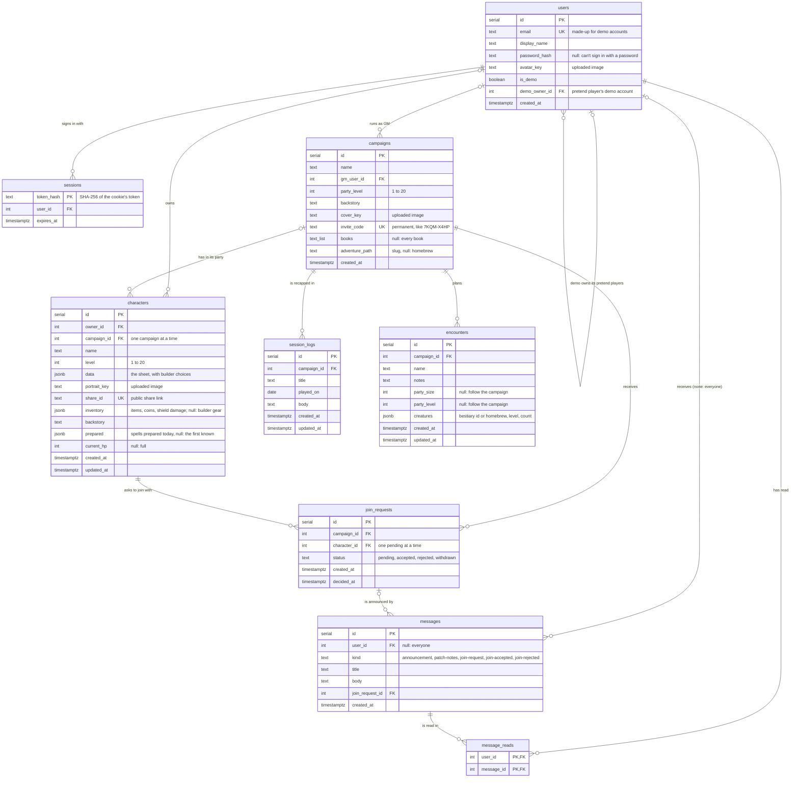

# Database schema

RollBound's Postgres tables, from `server/db/schema.sql` (`npm run db:setup` creates or
updates them). GitHub draws the diagram below. Update it when the schema changes.

## What happens on delete

| When this is deleted | These go with it | These stay, unlinked |
| --- | --- | --- |
| A user | their sessions, characters, messages, read marks, and pretend players (demo) | campaigns they ran (no GM)* |
| A campaign | its join requests, session logs, encounters, and those requests' messages | its characters (in no campaign) |
| A character | its join requests and their messages | |
| A join request | its messages | |
| A message | its read marks | |

\* Demo cleanup deletes a demo's campaigns itself, before deleting the account (`server/src/demo.js`).

## Rules that aren't foreign keys

- A character has **at most one pending join request** (a unique index on `character_id` where `status = 'pending'`).
- `campaigns.invite_code` and `characters.share_id` are unique, and `db:setup` fills them in for older rows and makes them required.
- A character's `level` and a campaign's `party_level` are 1 to 20, and `current_hp` is never negative.
- An encounter's `party_size` is 1 to 8 and its `party_level` 1 to 20 (both null to follow the campaign).
- `message_reads` covers messages for everyone too; messages for everyone from before a user signed up count as read without a row.

## Not in the database

- **Rules data** (ancestries, classes, feats, spells, items): JSON files in `packages/rules/data/`, loaded by the server and client. A character's `data` stores the IDs of what was chosen.
- **Adventure Paths**: `packages/rules/src/adventurePaths.js`. `campaigns.adventure_path` holds a slug from it.
- **Uploaded images**: in S3 (or `server/uploads/` locally). The `*_key` columns hold where each one is.
- **Inside the JSONB columns**: `characters.inventory` is `{ items, coins }`, where a shield item can carry `damage` (Hit Points lost; see `docs/shield-hit-points.md`), and `characters.prepared` is `{ cantrips, slots }` of spell ids. The rules package checks both before they're saved (`inventoryProblems`, `preparedProblems`).
- **Creatures**: `packages/rules/bestiary/`. An encounter's creatures hold a bestiary `creatureId` (or none, for homebrew) with a copy of the name and level.
